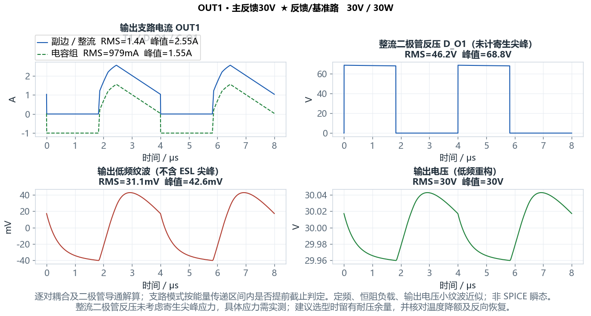

# 开关电源设计与环路分析工具

**Power Supply Design & Loop Analyzer**

一个在本地运行、由 AI 辅助开发并持续通过算例与仿真复核的电源设计工具。它将供电架构、功率级计算、器件损耗、磁件设计、控制环路和工程报告放进同一个工作流，减少重复录入，让设计结果可以追溯到输入参数和模型条件。

支持 Windows 桌面界面、本地网页版、Python API 和命令行。日常计算在用户电脑上完成；LTspice 仿真需要另行安装 LTspice。

## 主要功能

| 模块 | 功能 |
| --- | --- |
| 供电架构 | 拖动输入源、电源模块、LDO、负载和二极管 OR 汇流；编辑连接、支路压降及启用状态，进行级联电压与功率预算 |
| 功率级 | Buck、Boost、CCM/DCM 反激、准谐振反激、有源钳位正激；分别计算 Vinmin/Vinmax 工作点及关键波形 |
| 多路输出 | 隔离拓扑最多 6 路输出；选择主反馈路，按匝比估算其他输出；独立配置整流器、电容与绕组，评估耦合及交叉调整率 |
| 半导体损耗 | 固定值快速估算或导入曲线计算；MOS 转移特性、栅电荷、米勒平台与 t1–t8 分段；二极管 If–Vf 导通损耗 |
| 电容组 | 可增删的并联电容列表，每颗独立配置 C、ESR、ESL，计算分流、纹波和损耗 |
| 磁件 | 标准及自定义磁芯、匝数、磁密、Steinmetz 损耗、DCR、电流密度、热阻温升；窗口横截面、利兹线压扁与分层交错绕制评估 |
| 环路与补偿 | 功率级及补偿器 Bode 图、相位/增益裕度、二型/三型补偿、K 因子整定与补偿电路阻容反推 |
| BOM 与降额 | 厂家、型号、封装、额定值及降额对照；缺失额定值和未覆盖应力明确标注待复核 |
| 工程报告 | Word、Excel、JSON；参数表与图像结合；Excel 按模块分 Sheet，Vinmin/Vinmax 左右对照；汇总系统与各单元报告 |
| LTspice 联动 | 通用可配置行为控制器、可读 ASC 工程、仿真运行与计算对比；支持已实现的反激、QR、有源钳位正激及 Buck/Boost 模式 |
| 自动化接口 | 无 GUI 的计算服务、Python API、CLI 和 MCP 入口，便于与其他工程工具联动 |

### 计算图示例

随附三路反激算例中 OUT1 的电流、整流二极管反压、输出纹波和输出电压。下图属于模型计算波形。



## 使用流程

1. 在供电画布添加源、电源模块、OR 汇流及负载，建立供电关系。
2. 进入单元，选择拓扑，设置输入电压上下限、输出需求、频率和预设效率。
3. 配置器件、曲线、电容组、磁芯与绕组；多路输出选择主反馈路。
4. 检查工作点、损耗、波形、磁密与环路，逐项处理检查提示。
5. 按需导出 LTspice 工程，复核计算与开关仿真的差异。
6. 导出 Word/Excel 报告，保存工程 JSON 及系统连接。

## 快速开始

### Windows 便携版

本机最新已构建版本：`releases/Windows-x64/20261031-chart-ui-fix/`。

- 桌面版：在 `PowerDesignDesktop` 中双击 `SwitchingPowerSupplyDesign_V0.exe`。
- 本地网页版：在 `PowerDesignWeb` 中双击 `StartWeb.cmd`。

复制完整程序文件夹，必须保留 `_internal`。运行包自带 Python 和计算依赖，目标电脑不需要安装 Python/Node；查看 Word/Excel 需要兼容的办公软件。Git 仓库不包含 EXE、虚拟环境或历史发布包，克隆源码后可按下文运行或自行构建。

### 从源码启动桌面版

已在 Windows / Python 3.13 环境验证。建议使用独立环境：

```powershell
python -m venv .venv-web
.\.venv-web\Scripts\python.exe -m pip install -r requirements.txt
.\.venv-web\Scripts\python.exe desktop_entry.py
```

桌面版使用 Tkinter，Python 安装需包含 Tcl/Tk。

### 从源码启动本地网页版

另需 Node.js 20.19+、22.12+ 或 24+，以及 npm：

```powershell
powershell -NoProfile -ExecutionPolicy Bypass -File tools/setup_web.ps1
.\.venv-web\Scripts\python.exe run_web.py --open
```

准备脚本安装本项目环境的依赖并构建 Vue 前端。本地网页版通过 `127.0.0.1` 服务调用本机 Python 内核，不能只双击其中的 HTML 来替代服务。首次安装依赖需要联网，日常计算不用联网。

前端还保留独立 TypeScript 计算内核，其适用范围和 Python 版需要分别核对；组织专用的集成说明和部署脚本不在公开仓库中。

### Python API 与 CLI

```python
from design_api import run_design

report = run_design({
    "topology": "BUCK", "V_in": 24, "V_out": 12,
    "P_out": 24, "f_sw": 100e3, "L": 100e-6,
    "C_out": 220e-6,
})
print(report["ok"])
```

```powershell
.\.venv-web\Scripts\python.exe cli.py design --spec examples/40W_CCM_3OUT_FLYBACK.json --out output/design.json
```

## 随附算例

| 文件 | 用途 |
| --- | --- |
| [40W_CCM_3OUT_FLYBACK.json](examples/40W_CCM_3OUT_FLYBACK.json) | 三路 CCM 反激；文件名保留历史命名，实际需求以内容为准 |
| [90W_QR_L6565_300V.json](examples/90W_QR_L6565_300V.json) | L6565 逻辑参考 QR 反激，300 V 固定输入 |
| [33W_3OUT_ACF_MP6005_COMPACT.json](examples/33W_3OUT_ACF_MP6005_COMPACT.json) | 三路有源钳位正激，MP6005 逻辑参考 |
| [SYSTEM_AUX_ORING.json](examples/SYSTEM_AUX_ORING.json) | 多源竞争、OR 汇流及负载网络 |
| [SYSTEM_LDO.json](examples/SYSTEM_LDO.json) | 含 LDO 的系统供电架构 |

## 项目结构

```text
desktop_entry.py      桌面入口与系统画布
main.py               单元计算界面
design_engine/        共享计算服务、数据合同与结果快照
power_stage.py        拓扑工作点与功率级
loss_model.py         损耗与效率汇总
magnetics.py          磁件计算
plants.py             小信号模型
web_app/              本地 Web 服务、Vue 界面与 TypeScript 内核
resources/            运行所需图像、图标与 SPICE 模型
examples/             JSON 算例
docs/                 使用说明、模型边界、公式文档与教程
tests/                计算、界面、报告、仿真和发布检查
tools/                环境准备、数据导出、构建和校验脚本
packaging/            PyInstaller 配置与发布模板
```

个人数据、第三方参考资料、独立器件提取/视频工程、外部集成部署文件及生成产物留在本地，不纳入仓库当前源码快照。

## 构建与验证

```powershell
.\.venv-web\Scripts\python.exe -m pip install -r requirements-build.txt
powershell -NoProfile -ExecutionPolicy Bypass -File tools/build_release.ps1 -Target all -ReleaseId my-build
```

构建脚本拒绝覆盖同名发布目录。`tools/release_manifest.ps1` 校验文件清单，`tools/zip_release.ps1` 生成分发 ZIP。

代表性检查：

```powershell
.\.venv-web\Scripts\python.exe tests/design_engine_check.py
.\.venv-web\Scripts\python.exe tests/multi_output_charts_check.py
.\.venv-web\Scripts\python.exe tests/canvas_resources_check.py
.\.venv-web\Scripts\python.exe tests/resource_paths_check.py
```

部分检查仅适用于 Windows，需要显示会话、LTspice 或事先构建的运行包。检查通过说明对应代码路径和算例达到测试要求，不代表硬件已经验证。

## 文档

- [开始使用](开始使用.md)、[中文手册](docs/MANUAL_ZH.md)、[项目结构与发布](docs/PROJECT_STRUCTURE.md)
- [计算方法与公式说明（Word）](docs/reference/计算方法与公式说明.docx)、[多路反激入门教程（Word）](docs/tutorials/多路反激电源设计入门教程.docx)
- [系统架构](docs/SYSTEM_WORKSPACE.md)、[LDO](docs/LDO_DESIGN.md)、[BOM 与降额](docs/COMPONENT_BOM_DERATING.md)
- [并联 ESR 环路模型](docs/PARALLEL_ESR_LOOP.md)、[寄生参数模型](docs/PARASITIC_MODELS.md)、[仿真对比](docs/SPICE_COMPREHENSIVE_COMPARISON.md)
- [更新日志](CHANGELOG.md)、[图表 UI 修正](docs/CHART_UI_FIX.md)

## 模型边界与许可

本工具用于工程初选、教学及计算复核。效率、热、交叉调整率与寄生换流受模型假设和输入精度限制。计算波形、SPICE 波形、实测数据应分别标识。通用行为控制器参考芯片逻辑，不等同于原厂完整芯片模型。器件曲线、磁芯典型数据、寄生参数、安规和制造条件需结合规格书、样机及实测复核。

项目尚未指定开源许可证。仓库访问权限不代表授予第三方再分发许可；依赖库和参考资料遵循各自许可。
